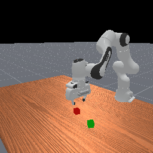
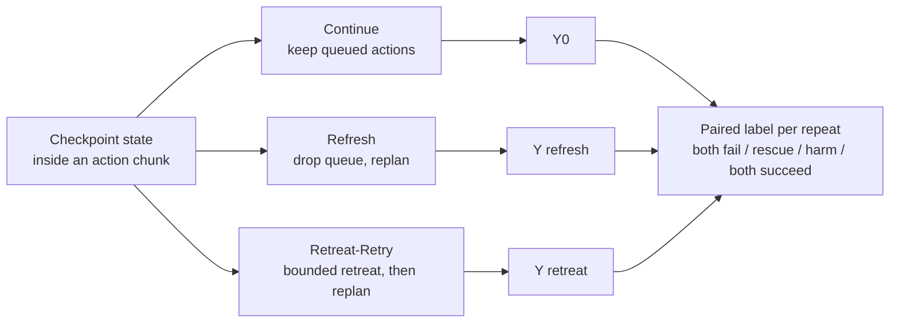
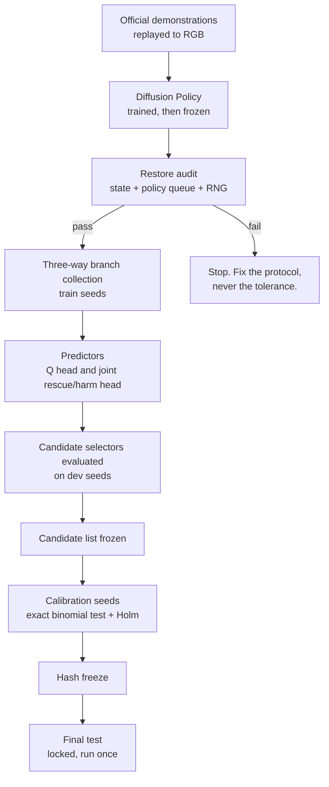
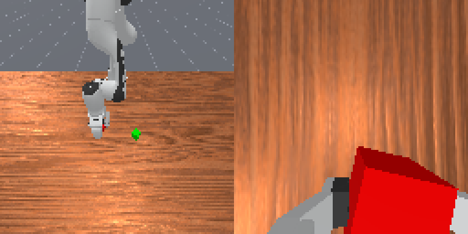
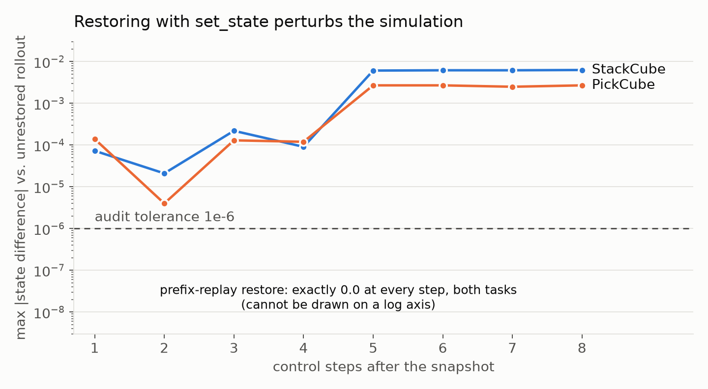

<!-- BANNER: add assets/banner.png here once the illustration is ready -->

# When Recovery Hurts

**Harm-Constrained Intervention for Robotic Manipulation** — research code, v0.3

A robot policy that is about to fail can sometimes be saved by intervening: throw away its current plan, or back off and try again. The same intervention can also break an episode that would have succeeded on its own. This repository studies **when to intervene, and with what, while bounding how often the intervention makes things worse.**

<p align="center">
  
</p>
<p align="center"><sub>StackCube-v1 in ManiSkill3, rendered on the experiment host. This clip replays an official motion-planning demonstration; it is not the learned policy.</sub></p>

> **Status: early pipeline validation.** The environment, rendering, demonstration conversion, policy training loop and state-restore check have been run on a real GPU host. No hypothesis in this project has been tested yet, and no success-rate or harm-rate claim is made. See [Current status](#current-status) for exactly what has and has not been run.

---

## Contents

- [The question](#the-question)
- [The three choices](#the-three-choices)
- [How an experiment runs](#how-an-experiment-runs)
- [The simulator](#the-simulator)
- [Current status](#current-status)
- [Finding: restoring simulator state by `set_state` is not exact](#finding-restoring-simulator-state-by-set_state-is-not-exact)
- [Installation](#installation)
- [Running the pipeline](#running-the-pipeline)
- [Repository layout](#repository-layout)
- [Experimental safeguards](#experimental-safeguards)
- [Scope and limitations](#scope-and-limitations)
- [Acknowledgements](#acknowledgements)

---

## The question

Take a frozen manipulation policy. Let `Y0 ∈ {0,1}` be the task outcome when the policy runs untouched, and `Yg ∈ {0,1}` the outcome when a selector `g` is allowed to intervene at most once. We want

```
maximize   P(Yg = 1)
subject to H(g) = P(Yg = 0 | Y0 = 1) ≤ ε
```

`H` is the **outcome-harm rate**: among episodes the base policy would have solved, the fraction the selector turned into failures. It is a statement about task success in a simulator under a declared random coupling. It is *not* a measure of collision, hardware damage or human safety.

Every paired episode falls into one of four cells:

| | intervention succeeds | intervention fails |
|---|---|---|
| **baseline succeeds** | both succeed | **harm** |
| **baseline fails** | **rescue** | both fail |

Raising success means collecting rescues. The constraint limits harms. A selector that only predicts "the policy is about to fail" controls neither directly, which is the motivation for the hypotheses below.

### Hypotheses (not yet tested)

- **H1.** The effect of an intervention depends on the state, the task phase and the kind of intervention; a fixed risk ordering does not explain it.
- **H2.** Calibrating the outcome-harm rate directly admits more useful interventions than limiting the false-alarm rate.
- **H3.** With the same observations, branch data and calibration, predicting rescue and harm separately adds decision value over a success-probability (Q) estimator.

The code currently implements the comparison needed for H3. The false-alarm-calibrated control for H2 is planned.

## The three choices

The base policy is a Diffusion Policy that predicts 16 actions and executes 8 of them before replanning.

| Choice | What it does | Cost |
|---|---|---|
| **Continue** | Keep executing the queued actions. | none |
| **Refresh** | Discard the remaining queued actions and replan from the current observation history. Only allowed *inside* a chunk, never at a natural replanning boundary, where it would be identical to Continue. | none |
| **Retreat–Retry** | Discard the queue, execute a bounded end-effector retreat with real control steps (default: up to 5 cm, at most 5 mm per step, 12 steps), then replan. The gripper command is held. | consumes steps from the original horizon |

At most one non-Continue choice is allowed per episode. A retreat is a physical action executed through `env.step`; it is never a `reset` or a state overwrite, and it is not assumed to be safe.



## How an experiment runs



**Branch data.** At each checkpoint step of a training episode the runner snapshots the simulator, the policy's action queue and observation history, and all random generators. It then runs Continue, Refresh and Retreat–Retry from that same state, several times. Repeats differ only in the key of the *future* policy noise; the past is identical. Labels compare each intervention with the Continue outcome of the same repeat.

**Random coupling.** Policy noise is keyed by `(episode seed, physical control step, repeat, stream)`, so the same physical moment gets the same noise no matter how many times the policy was called before it. This is one choice of counterfactual coupling, not the only valid one.

**Selectors compared.**

| Family | Rule |
|---|---|
| `never` | the base policy alone |
| `timer` | a fixed intervention at the first eligible check after a fixed time |
| `random` | a fixed intervention with fixed probability at each check |
| `risk_q` | intervene when estimated failure risk passes a threshold; pick the kind with the Q head |
| `q` | intervene when the estimated success gain passes a threshold |
| `joint` | intervene on `P(rescue) − P(harm)`, optionally with an extra harm penalty |

The Q head is a supervised Monte-Carlo success estimator, not Q-learning. Both learned heads use the same frozen visual features, the same branch data and a two-layer MLP. Selectors see RGB, joint positions and velocities, TCP pose, past actions and the step count. They never see object poses, the success signal or future labels.

**Calibration.** For a fixed, pre-declared list of candidate selectors, the harm rate of each is tested on held-out episodes with an exact binomial test and Holm correction (the Learn-then-Test principle applied to a finite candidate set). If the sample is too small, nothing but `never` passes; that outcome is reported, not hidden.

## The simulator

All experiments run in [ManiSkill3](https://github.com/mani-skill/ManiSkill) at a pinned commit, with a Panda arm carrying a wrist camera.

<p align="center">
  
</p>
<p align="center"><sub>StackCube-v1: approach, grasp, lift, move, place. Frames from a replayed official demonstration (seed 0, 107 control steps).</sub></p>

<p align="center">
  
</p>
<p align="center"><sub>What the policy and the selector actually see: two 128×128 RGB images (base camera, wrist camera), plus joint state and TCP pose. Shown enlarged.</sub></p>

| Setting | Value |
|---|---|
| Simulator | ManiSkill3 v3.0.1, commit `a4a4f927` |
| Robot | `panda_wristcam` |
| Physics | PhysX CPU, one environment; GPU is used for rendering and networks |
| Control | `pd_ee_delta_pos` (StackCube, PickCube), `pd_ee_delta_pose` (PegInsertionSide) |
| Observation | RGB 2×128×128, `qpos` (9), `qvel` (9), TCP pose (7) |
| Policy | official RGB Diffusion Policy baseline: observation horizon 2, prediction 16, execution 8 |
| Tasks | PickCube (installation check), StackCube (first pilot), PegInsertionSide (second task) |
| Horizon | 200 control steps (StackCube); success is "first time the task condition holds", then the episode ends |
| Primary levels | ε = 0.05, δ = 0.05 |

Single-environment CPU physics was chosen so that branch restoration can be verified against the official CPU demonstrations first. It is an operational decision, not a claim about GPU physics.

## Current status

Last updated 2026-11-13. Host: one rented RTX 3090 (24 GB), Ubuntu 22.04, Python 3.10, torch 2.6.0+cu124, sapien 3.0.3.

| Stage | Item | Result |
|---|---|---|
| 0 | Pinned install, `pip check` | pass |
| 0 | CPU unit and mock tests | 50 passed |
| 0 | CUDA and Vulkan (`hci doctor`) | pass |
| 0 | RGB rendering and restore smoke, PickCube and StackCube | pass after the restore fix below (state, RGB and success difference all exactly 0.0) |
| 1 | Demonstration conversion to RGB | 20/20 valid; second set 99/100 valid |
| 1 | Short training run (500 iterations) | runs end to end; 19 it/s at batch 64, peak 2.4 GB VRAM; 0/5 evaluation successes, as expected at this length |
| 1 | Base policy, 30,000 iterations | **in progress** |
| 2 | Restore audit with the real policy | not run yet |
| 2 | Three-way branch collection on 2 seeds | not run yet |
| 3–6 | Pilot, development, calibration, final test | not run |

What this does **not** show: that the base policy solves the task, that any selector helps, or that any hypothesis holds. Unit tests check Python logic on mock physics; they say nothing about manipulation success.

## Finding: restoring simulator state by `set_state` is not exact

Branching experiments rest on one assumption: after restoring a snapshot, the simulation continues exactly as it would have without the snapshot. On the pinned ManiSkill/PhysX CPU backend this did **not** hold for `set_state_dict`, and the project's own smoke test caught it.

<p align="center">
  
</p>

Measured on the experiment host (seed 7, fixed small random actions, data in [`results/stage0/restore_divergence.csv`](results/stage0/restore_divergence.csv)):

| Comparison | Max abs state difference |
|---|---|
| `reset(seed)` + same actions, twice | 0.0 |
| rollout after restore vs. another rollout after the same restore | 0.0 |
| rollout **without** restore vs. rollout after `set_state` restore | 7e-5 after 1 step, 6e-3 after 8 steps |
| re-writing only the robot's state | 0.0 |
| re-writing only the rigid objects' state (same values) | 7e-5 after 1 step |

Writing a rigid body's state back, even with identical values, changes the next contact solve. That internal solver state is not part of the state dictionary, so it cannot be saved. Joint drive targets, joint forces and link velocities were checked and are not the cause.

**Fix.** Restoration no longer calls `set_state_dict`. It resets the episode with its seed and **replays the logged actions**, then checks the replayed state against the snapshot at the unchanged tolerance of 1e-6 and raises if they differ. Policy queue, observation history and random generators are restored afterwards. With this, restored and unrestored rollouts agree exactly in both tasks. The tolerance was not relaxed. The cost is extra physics and rendering steps per branch (no policy inference); it will be measured in the two-seed collection.

Details, including two interface fixes found on the host, are in [`amendments/AMENDMENT_001_restore_by_prefix_replay.md`](amendments/AMENDMENT_001_restore_by_prefix_replay.md).

## Installation

Requirements: Linux, an NVIDIA GPU with Vulkan available to the process, Python 3.10 or 3.11. In a container, the NVIDIA `graphics` driver capability must be enabled **when the container is created**; exporting it afterwards does not mount the missing libraries.

```bash
git clone https://github.com/justinbrianhwang/when-recovery-hurts.git
cd when-recovery-hurts
bash scripts/00_system_packages.sh      # user-space packages only; never touches drivers
bash scripts/01_bootstrap_vast.sh       # venv, torch 2.6.0+cu124, pinned ManiSkill source
source .venv/bin/activate
export MS_SKIP_ASSET_DOWNLOAD_PROMPT=1 WANDB_MODE=disabled
python -m hci doctor --out runs/doctor_001
bash scripts/06_validate_local.sh validation/server_core_001
```

`01_bootstrap_vast.sh` clones ManiSkill into `third_party/` at commit `a4a4f9272ad64b1564035874b605ceb687b63ed8` and refuses to continue on any other revision. Nothing from upstream is vendored in this repository.

## Running the pipeline

Every command writes to a new run directory and refuses to overwrite an existing one. The full sequence with explanations is in [`QUICKSTART.md`](QUICKSTART.md) (Korean).

```bash
# 1. Rendering + restore smoke test
python -m hci smoke --config configs/pickcube.yaml  --out runs/smoke_pick_001
python -m hci smoke --config configs/stackcube.yaml --out runs/smoke_stack_001

# 2. Demonstrations -> RGB
bash scripts/02_prepare_demos.sh StackCube-v1 20
export STACK_DEMO="$(python -c 'from mani_skill import DEMO_DIR; print(DEMO_DIR)')/StackCube-v1/motionplanning/trajectory.rgb.pd_ee_delta_pos.physx_cpu.h5"

# 3. Base policy (dry run by default; --execute starts training)
python scripts/03_train_dp.py --config configs/stackcube.yaml --demo "$STACK_DEMO" \
  --run stack_s1 --num-demos 20 --total-iters 30000 --eval-freq 1000 --execute
python scripts/04_export_policy.py --run runs/policy/stack_s1 \
  --checkpoint runs/policy/stack_s1/checkpoints/best_eval_success_once.pt \
  --out artifacts/policies/stack_s1

# 4. Restore audit with the real policy. Must pass before any collection.
python -m hci audit --config configs/stackcube.yaml \
  --policy artifacts/policies/stack_s1 --out runs/audit_stack_001

# 5. Three-way branch collection, two seeds first
python -m hci collect --config configs/stackcube.yaml --policy artifacts/policies/stack_s1 \
  --audit runs/audit_stack_001/audit.json --episodes 2 --out runs/branches_smoke_001
python scripts/inspect_branches.py --data runs/branches_smoke_001
```

Later stages (`fit-heads`, `evaluate`, `summarize`, `certify`, `freeze`, `verify-freeze`) are described in `QUICKSTART.md`. `python -m hci --help` lists all subcommands.

> Note on short runs: the upstream trainer saves a periodic checkpoint only when `iteration % save_freq == 0` and a `best_eval_*` checkpoint only when evaluation success is above zero. A 500-iteration run with `--eval-freq 500` therefore leaves only the untrained `0.pt`. Use a smaller `--eval-freq` for plumbing checks.

### Recording intervention videos

```bash
python scripts/record_episode.py --config configs/stackcube.yaml \
  --policy artifacts/policies/stack_s1 --seed 20000 --action continue --out runs/video_continue_001
python scripts/record_episode.py --config configs/stackcube.yaml \
  --policy artifacts/policies/stack_s1 --seed 20000 --action refresh --at 12 --out runs/video_refresh_001
python scripts/record_episode.py --config configs/stackcube.yaml \
  --policy artifacts/policies/stack_s1 --seed 20000 --action retreat_retry --at 12 --out runs/video_retreat_001
```

The recorder accepts audit, train and dev seeds only.

### Figures

```bash
python scripts/make_figures.py     # redraws assets/*.png from the measurements in results/
```

## Repository layout

```
src/hci/            research code; CLI entry point is `python -m hci`
  simulation.py       environment, snapshot/restore by prefix replay, Refresh and Retreat
  policies.py         Diffusion Policy adapter, action queue, observation history
  observations.py     observation whitelist shared by training and evaluation
  experiment.py       restore audit, branch collection, candidate evaluation
  models.py           Q head and joint rescue/harm head
  decisions.py        candidate selectors
  statistics.py       exact binomial test, Holm, paired metrics, bootstrap
  reporting.py        summaries and candidate certification
  freeze.py           hash freeze and the locked final-test command
scripts/            install, demo conversion, training launcher, export, recording, figures
configs/            per-task YAML, candidate registry, seed splits
tests/              unit and mock-physics tests (no simulator required)
docs/               scope, protocol, data and statistics specifications (Korean)
amendments/         dated records of every protocol or code change after the initial package
results/            small measurement files behind the figures
assets/             images used in this README
templates/          stage report and amendment forms
validation/         checks recorded when the initial package was built (CPU only)
```

## Experimental safeguards

- **Seed-level splits.** Audit, train, dev, calibration and test use disjoint initial-scene seeds (5 / 120 / 100 / 400 / 400). All checkpoints, branches and repeats of a seed stay in one split; overlap is rejected at load time.
- **No overwriting.** Run directories are created exclusively. Failed runs are kept and re-run under a new ID.
- **No silent exclusions.** An interrupted collection stays `completed: false` and the trainer refuses it.
- **Restore is checked every time.** Each restore verifies the replayed state against the snapshot and raises on mismatch. Evaluation also re-runs every episode without intervention and stops if the two baseline outcomes differ.
- **Observation whitelist.** Policy and selectors receive RGB, `qpos`, `qvel` and TCP pose only.
- **Candidates fixed before calibration.** Changing a predictor or the candidate list after looking at calibration data turns that data into development data.
- **Locked final test.** The test split is reachable only through `frozen-test`, after a hash freeze of code, weights, configuration and environment, and with an explicit approval token.

## Scope and limitations

- **Simulation only.** Do not connect this code to hardware. The retreat primitive does not avoid collisions or joint limits.
- "Harm" means a worse task outcome under a declared random coupling in one simulator.
- Evaluation is synchronous: physics time stops during network inference, so nothing here supports a real-time claim.
- Restore exactness is verified at the tested seeds and states; it is not a proof of global simulator determinism.
- The four-cell outcome definition, branch rollouts and the Learn-then-Test principle are existing ideas and are not claimed as contributions.
- Not included: trained weights, demonstration files, rate-matched random and timer controls, the false-alarm-calibrated control for H2, multiple policy seeds, observation ablations, coupling and latency sensitivity.

## Acknowledgements

This project builds on [ManiSkill3](https://github.com/mani-skill/ManiSkill) and its official Diffusion Policy baseline, on [Diffusion Policy](https://diffusion-policy.cs.columbia.edu/) (Chi et al.), and on [Learn then Test](https://arxiv.org/abs/2110.01052) (Angelopoulos et al.). Upstream code and data are downloaded at install time under their own licenses; see [`THIRD_PARTY_NOTICES.md`](THIRD_PARTY_NOTICES.md) and [`docs/SOURCES.md`](docs/SOURCES.md).

A paper describing this work is in preparation.
