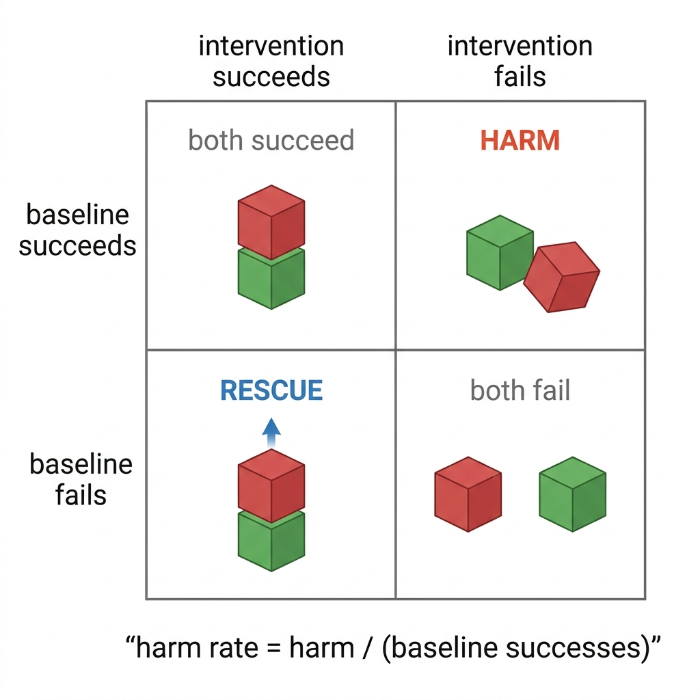
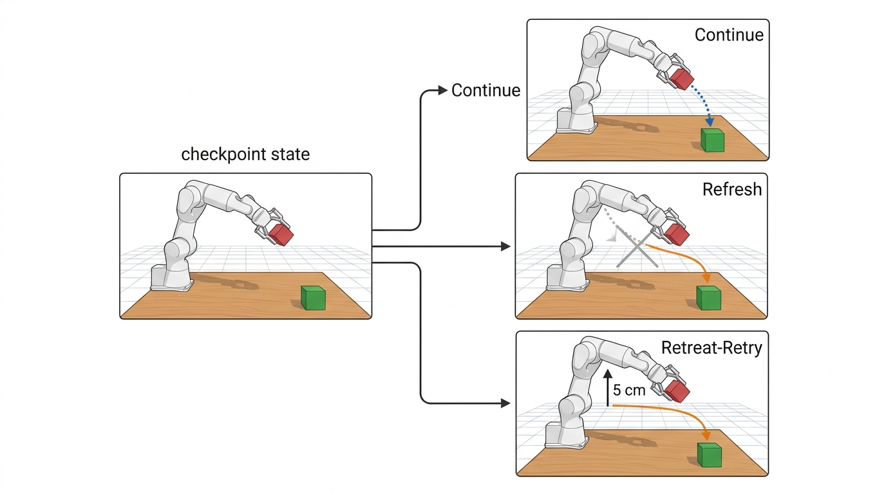
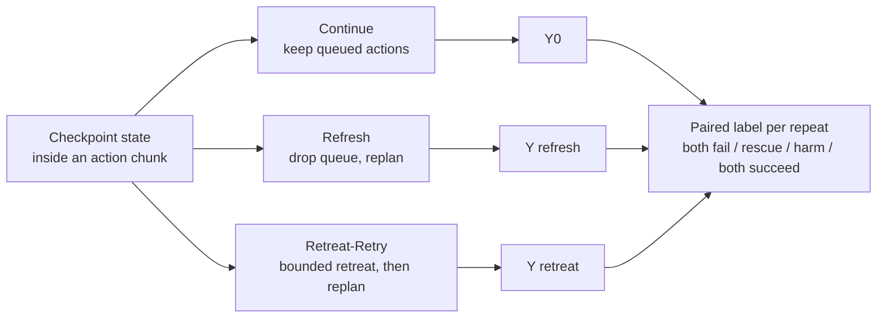
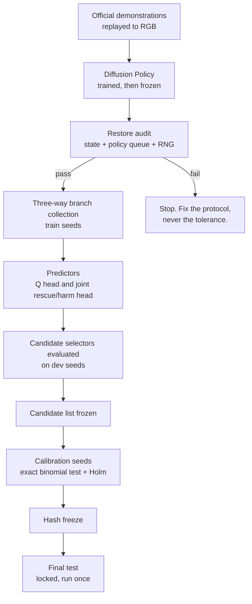
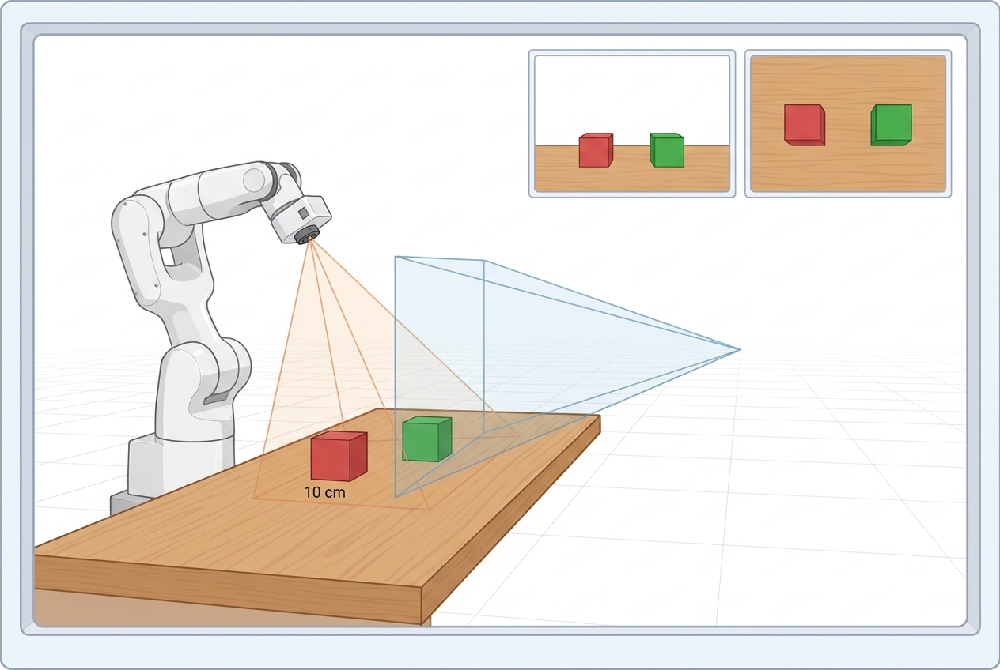
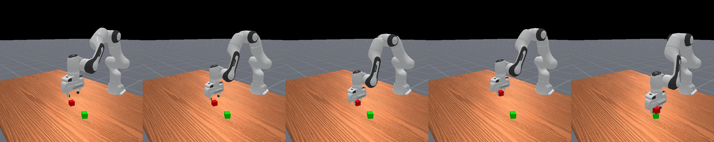
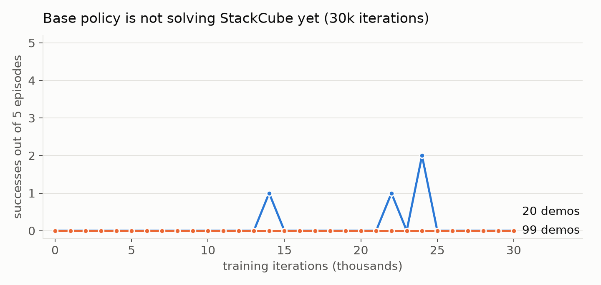
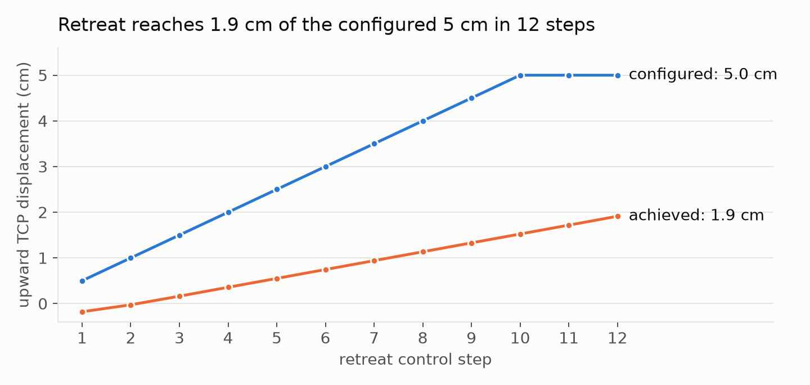
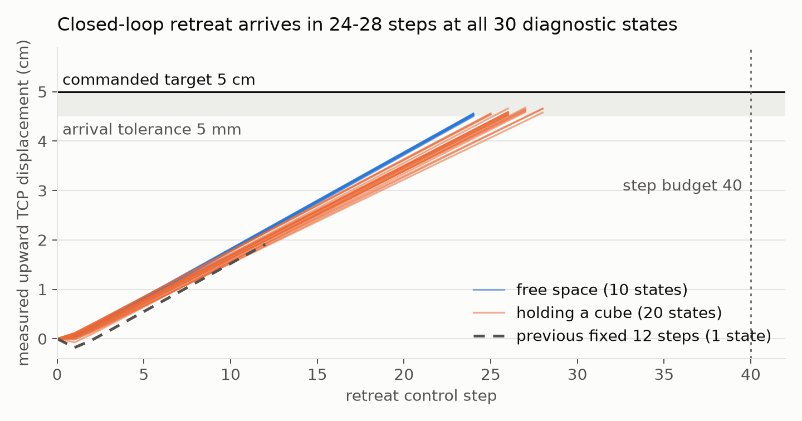

<p align="center">
  
</p>
<p align="center"><sub>Conceptual illustration, not a photograph of an experiment. All experiments in this repository run in simulation.</sub></p>

# When Recovery Hurts

**Harm-Constrained Intervention for Robotic Manipulation** — research code, v0.3

A robot policy that is about to fail can sometimes be saved by intervening: throw away its current plan, or back off and try again. The same intervention can also break an episode that would have succeeded on its own. This repository studies **when to intervene, and with what, while bounding how often the intervention makes things worse.**

<p align="center">
  
</p>
<p align="center"><sub>StackCube-v1 in ManiSkill3, rendered on the experiment host. This clip replays an official motion-planning demonstration; it is not the learned policy.</sub></p>

> **Status: early pipeline validation.** The environment, rendering, demonstration conversion, policy training loop and state-restore check have been run on a real GPU host. No hypothesis in this project has been tested yet, and no success-rate or harm-rate claim is made. See [Current status](#current-status) for exactly what has and has not been run.

---

## Contents

- [The question](#the-question)
- [The three choices](#the-three-choices)
- [How an experiment runs](#how-an-experiment-runs)
- [The simulator](#the-simulator)
- [Current status](#current-status)
- [Finding: restoring simulator state by `set_state` is not exact](#finding-restoring-simulator-state-by-set_state-is-not-exact)
- [Installation](#installation)
- [Running the pipeline](#running-the-pipeline)
- [Repository layout](#repository-layout)
- [Experimental safeguards](#experimental-safeguards)
- [Scope and limitations](#scope-and-limitations)
- [Acknowledgements](#acknowledgements)

---

## The question

Take a frozen manipulation policy. Let `Y0 ∈ {0,1}` be the task outcome when the policy runs untouched, and `Yg ∈ {0,1}` the outcome when a selector `g` is allowed to intervene at most once. We want

```
maximize   P(Yg = 1)
subject to H(g) = P(Yg = 0 | Y0 = 1) ≤ ε
```

`H` is the **outcome-harm rate**: among episodes the base policy would have solved, the fraction the selector turned into failures. It is a statement about task success in a simulator under a declared random coupling. It is *not* a measure of collision, hardware damage or human safety.

Every paired episode falls into one of four cells:

| | intervention succeeds | intervention fails |
|---|---|---|
| **baseline succeeds** | both succeed | **harm** |
| **baseline fails** | **rescue** | both fail |

<p align="center">
  
</p>
<p align="center"><sub>Schematic of the four paired outcomes. The harm rate is undefined when the baseline never succeeds.</sub></p>

Raising success means collecting rescues. The constraint limits harms. A selector that only predicts "the policy is about to fail" controls neither directly, which is the motivation for the hypotheses below.

### Hypotheses (not yet tested)

- **H1.** The effect of an intervention depends on the state, the task phase and the kind of intervention; a fixed risk ordering does not explain it.
- **H2.** Calibrating the outcome-harm rate directly admits more useful interventions than limiting the false-alarm rate.
- **H3.** With the same observations, branch data and calibration, predicting rescue and harm separately adds decision value over a success-probability (Q) estimator.

The code currently implements the comparison needed for H3. The false-alarm-calibrated control for H2 is planned.

## The three choices

The base policy is a Diffusion Policy that predicts 16 actions and executes 8 of them before replanning.

| Choice | What it does | Cost |
|---|---|---|
| **Continue** | Keep executing the queued actions. | none |
| **Refresh** | Discard the remaining queued actions and replan from the current observation history. Only allowed *inside* a chunk, never at a natural replanning boundary, where it would be identical to Continue. | none |
| **Retreat–Retry** | Discard the queue, execute a bounded end-effector retreat with real control steps (default: a target 5 cm above the current TCP, at most 5 mm commanded per step, ending when the measured TCP is within 5 mm of the target or after 40 steps), then replan. The gripper command is held. | consumes steps from the original horizon |

<p align="center">
  
</p>
<p align="center"><sub>Schematic. From the same restored state, the three choices are rolled out separately. The 5 cm of Retreat–Retry is the commanded target; the displacement actually achieved is measured and reported separately.</sub></p>

At most one non-Continue choice is allowed per episode. A retreat is a physical action executed through `env.step`; it is never a `reset` or a state overwrite, and it is not assumed to be safe.



## How an experiment runs



**Branch data.** At each checkpoint step of a training episode the runner snapshots the simulator, the policy's action queue and observation history, and all random generators. It then runs Continue, Refresh and Retreat–Retry from that same state, several times. Repeats differ only in the key of the *future* policy noise; the past is identical. Labels compare each intervention with the Continue outcome of the same repeat.

**Random coupling.** Policy noise is keyed by `(episode seed, physical control step, repeat, stream)`, so the same physical moment gets the same noise no matter how many times the policy was called before it. This is one choice of counterfactual coupling, not the only valid one.

**Selectors compared.**

| Family | Rule |
|---|---|
| `never` | the base policy alone |
| `timer` | a fixed intervention at the first eligible check after a fixed time |
| `random` | a fixed intervention with fixed probability at each check |
| `risk_q` | intervene when estimated failure risk passes a threshold; pick the kind with the Q head |
| `q` | intervene when the estimated success gain passes a threshold |
| `joint` | intervene on `P(rescue) − P(harm)`, optionally with an extra harm penalty |

The Q head is a supervised Monte-Carlo success estimator, not Q-learning. Both learned heads use the same frozen visual features, the same branch data and a two-layer MLP. Selectors see RGB, joint positions and velocities, TCP pose, past actions and the step count. They never see object poses, the success signal or future labels.

**Calibration.** For a fixed, pre-declared list of candidate selectors, the harm rate of each is tested on held-out episodes with an exact binomial test and Holm correction (the Learn-then-Test principle applied to a finite candidate set). If the sample is too small, nothing but `never` passes; that outcome is reported, not hidden.

## The simulator

All experiments run in [ManiSkill3](https://github.com/mani-skill/ManiSkill) at a pinned commit, with a Panda arm carrying a wrist camera.

<p align="center">
  
</p>
<p align="center"><sub>Schematic of the scene and its two cameras, not to scale: the cubes in StackCube-v1 are 4 cm on a side, not the 10 cm written in the drawing. The images below are actual simulator renders.</sub></p>

<p align="center">
  
</p>
<p align="center"><sub>StackCube-v1: approach, grasp, lift, move, place. Frames from a replayed official demonstration (seed 0, 107 control steps).</sub></p>

<p align="center">
  
</p>
<p align="center"><sub>What the policy and the selector actually see: two 128×128 RGB images (base camera, wrist camera), plus joint state and TCP pose. Shown enlarged.</sub></p>

| Setting | Value |
|---|---|
| Simulator | ManiSkill3 v3.0.1, commit `a4a4f927` |
| Robot | `panda_wristcam` |
| Physics | PhysX CPU, one environment; GPU is used for rendering and networks |
| Control | `pd_ee_delta_pos` (StackCube, PickCube), `pd_ee_delta_pose` (PegInsertionSide) |
| Observation | RGB 2×128×128, `qpos` (9), `qvel` (9), TCP pose (7) |
| Policy | official RGB Diffusion Policy baseline: observation horizon 2, prediction 16, execution 8 |
| Tasks | PickCube (installation check), StackCube (first pilot), PegInsertionSide (second task) |
| Horizon | 200 control steps (StackCube); success is "first time the task condition holds", then the episode ends |
| Primary levels | ε = 0.05, δ = 0.05 |

Single-environment CPU physics was chosen so that branch restoration can be verified against the official CPU demonstrations first. It is an operational decision, not a claim about GPU physics.

## Current status

Last updated 2026-11-14. Host: one rented RTX 3090 (24 GB), Ubuntu 22.04, Python 3.10, torch 2.6.0+cu124, sapien 3.0.3.

| Stage | Item | Result |
|---|---|---|
| 0 | Pinned install, `pip check` | pass |
| 0 | CPU unit and mock tests | 50 passed |
| 0 | CUDA and Vulkan (`hci doctor`) | pass |
| 0 | RGB rendering and restore smoke, PickCube and StackCube | pass after the restore fix below (state, RGB and success difference all exactly 0.0) |
| 1 | Demonstration conversion to RGB | 20/20 valid; second set 99/100 valid |
| 1 | Training loop, checkpointing, export | runs end to end; 19 it/s at batch 64, peak 2.4 GB VRAM |
| 1 | **Base policy quality** | **not good enough yet**: 0/20 successes on dev seeds after 30,000 iterations on 99 demonstrations |
| 2 | Restore audit with the real policy, 5 seeds | pass; state, observation and action differences all exactly 0.0, also after an intervention branch |
| 2 | Three-way branch collection, 2 seeds | complete: 96 branch rollouts, 12.2 s each |
| 2 | Intervention behaviour check and videos | recorded; see below |
| 1B | Policy input/output parity audit (training data, in-training evaluation, deployment adapter) | pass: 42 observation histories from 6 episodes identical, action chunks identical under the same RNG (difference 0.0) |
| 1B | Demonstrations for the next base policy | 129/130 converted; first 100 fixed as the training set, 10 replayed by action and all succeeded |
| 1B | Closed-loop retreat diagnostic, 30 states | all 30 reached the 5 cm target within tolerance in 24–28 steps |
| 1B | Base policy, 100 demonstrations, 100,000 updates, batch 256 | **not qualified**: 4/100 successes on the qualification seeds (Wilson 95% interval 1.6%–9.8%; operating threshold 50/100). No second training run was started |
| 1B | Where the failures stop (12 re-run development episodes, descriptive) | 8 of 10 failures never reached the cube to be grasped (closest approach 3–9 cm); 2 grasped and lifted it but never brought it over the target cube |
| 1C | Diagnosis of the unqualified policy: input/output parity with the new weights | pass: 42 histories and 42 action chunks identical across training data, in-training evaluation and deployment paths |
| 1C | Recorded expert actions replayed on 20 demonstration scenes, three environment set-ups | 60/60 succeed, at the recorded step |
| 1C | **Policy on scenes it was trained on vs. demonstration scenes it never saw** (10 each, closed loop) | **6/10 vs. 0/10** (5/10 vs. 0/10 with the plain runtime reset). Small sample: a direction, not a rate |
| 1C | Generated actions on recorded histories, 4 fixed noise seeds | error about 3× larger and denoising loss about 46× larger on unseen demonstrations |
| 1C | Does the file-vs-live RGB difference change the actions? | the difference is almost entirely ±1 intensity; swapping it in changes the action by about 5–6% of the seed-to-seed variation |
| 2A | Exploratory recovery pilot with the fixed D500-clean policy (base policy still below the gate; see below) | restore audit pass at 18 checkpoints; 24 train scenes, 364 paired blocks, 1,092 branch continuations, all reproducibility checks identical. Descriptive only |
| 2B | Four-arm control on 24 new train scenes: Continue, Continue with another future noise key, Refresh, Retreat–Retry (same policy, still below the gate; see below) | restore audit pass at 18 checkpoints; 336 blocks, 1,344 continuations; the noise-only arm matched Continue exactly until the old action queue was used up in 336/336 blocks. In this sample the mean outcome of Refresh was within 0.03 of both Continue arms and that of forced Retreat–Retry was 0.16–0.25 lower. Descriptive only |
| 2C | Offline review of the saved Stage 2B records (no simulator, no GPU, nothing trained; planned after the 2B results were seen) | the 2B counts were reproduced from the raw rows; choosing an arm from three noise repeats of a state and reading it on the fourth gave scene means 0.01–0.03 above Continue, carried by 2–4 of 24 scenes; during the retreat itself the recorded grasp, lift and alignment flags never switched off. Descriptive only |
| 2D | Three control arms that hand control back at the same step, on 12 new train scenes: the existing 5 cm retreat, a 2 cm move then hold, and holding in place (same policy, still below the gate; see below) | restore audit pass at 18 checkpoints; 176 blocks, 704 continuations; first inference after the control part at the same step with the same seed in 176/176 blocks. Successful blocks: Continue 25, 5 cm 32, 2 cm 26, hold 29; the direction of the differences reversed between checkpoints. Descriptive only |
| 3A | First observation-based selector between Continue and the existing 5 cm retreat, fitted on the saved Stage 2B and 2D records and read with whole scenes held out (CPU only, no new rollout; planned after those results were seen) | inputs intact and the two stages compatible on 12 checks; 38 fits converged. Scenes that succeed when one intervention is read from the stored paths: never intervening 8/24 and 3/12; the observation models 8/24 and 2–3/12; the time-only model 8/24 and 3/12. No gain over not intervening was found. Descriptive only |
| 3B | The same selector with all 568 saved feature dimensions instead of 8 principal components; one CPU run with entry criteria fixed beforehand (decided after the 3A result was seen) | the Stage 3A controls were reproduced exactly; successful scenes when one intervention is read from the stored paths: never intervening 8/24 and 3/12, the two candidates 6–7/24 and 3/12. No entry criterion on outcomes was met; model search for this configuration is closed for this cycle. Descriptive only |
| H1 | A follow-up contrast, separate from the closed Stage 3B, run once on 12 new train scenes: after the existing 5 cm retreat, give the policy the latest observation twice for its first re-inference (`R_PAD_ONCE`) instead of the real last two (`R_KEEP`), with the same state, step and noise | restore audit pass; 180 blocks, 540 continuations; the two retreat arms were identical up to the return step in 360/360 branches and the padding changed nothing but the earlier history entry. Successful blocks: Continue 19, `R_KEEP` 17, `R_PAD_ONCE` 11; padding turned 8 blocks from success to failure and 2 the other way (scene-mean difference −0.043). The first action chunk changed in every block, by small amounts. Descriptive only; data in [`results/handoff_h1_001/`](results/handoff_h1_001/) |
| Vision-V1 | Replace the base policy's small unpretrained image encoder with an ImageNet-pretrained ResNet-18 (same 500 demonstrations, train seeds 1 and 2, fixed 80k EMA candidate, new selection and qualification seed sets); run once | a first execution stopped at the budget gate before training. Second execution: both trainings completed; on the 100 selection scenes the candidates reached 85 (seed 1, selected) and 83 (seed 2). On 100 new qualification scenes, used once, the selected policy succeeded in **79** and the frozen legacy policy in **28** (both 25, new only 54, legacy only 3, neither 18); predeclared label `TARGET_MET`. Remaining failures of the new policy are mostly at the last stage (11 of 21 aligned without completing the placement). Development result on one task; pretraining is not separated from encoder size; not the final Test. Data in [`results/vision_v1_001/`](results/vision_v1_001/) |
| Recovery-V1 diagnostic | Find the mechanism of the remaining failures of the Vision-V1 policy (frozen, train seed 1, 80k EMA): one pass without intervention on 100 new scenes (seeds 50600–50699) with a per-step ground-truth trace and one mechanism label per failed episode by rules fixed beforehand; run once | 79/100 successful, 21 failures, none unexplained by the rules: never near the cube 5, three release labels 5 + 5 + 3, others 3. Read after the run (post hoc): the 14 release failures all let go of the cube 1.7–4.7 cm off-centre over the target (successes: median 1.0 cm, at most 2.3 cm); up to 1.5 cm offset 62 episodes with 0 failures, above 2.5 cm 8 with 8 failures; release height did not differ. An association in one development set, not tested by intervention. Proposed, not run: a bounded horizontal centring move before the release, to be compared with no intervention and the 5 cm retreat from the same state. Data in [`results/recovery_v1_diagnostic/`](results/recovery_v1_diagnostic/) |
| Recovery-V1 oracle XY pilot | Test the diagnostic's reading by intervention: at the policy's first pending release command, compare no intervention, the existing 5 cm retreat, holding in place for a matched number of steps, and a bounded horizontal centring move (at most 5 mm commanded per step, target within 3 cm, at most 12 steps) on 100 new scenes (seeds 50700–50799). The centring arm reads exact simulator cube positions and is a diagnostic reference, not a deployable controller | **run once** (development data; the centring arm is an oracle, not deployable). Successful scenes of 100: no intervention 82, 5 cm retreat 73, matched hold 82, oracle centring 92. Centring against no intervention: 10 failures became successes, 0 successes became failures (net +10); against the matched hold also 10 and 0, so the gain is not explained by interrupting, waiting and re-planning. The retreat turned 14 successes into failures and 5 failures into successes. The trigger fired in 95 scenes with no false trigger; in 48 the offset was already within 1.0 cm and nothing was moved; in the other 47 the arm moved 0.05–2.3 cm (median 0.6 cm) and the policy never released farther from the centre than where the move ended. 8 failures remain under centring: 5 scenes without a trigger (the policy never carried the cube), 2 where the carried cube pushed the target cube along, 1 that triggered at the last step. The pre-set follow-up gate is met (`ORACLE_GATE_PASS`): it says a non-oracle estimator is worth developing, nothing about perception. One task, one policy, one noise repeat; no significance claim. Cost US$0.44 of a US$2.50 cap. Records in [`results/recovery_v1_oracle_xy_pilot_001/`](results/recovery_v1_oracle_xy_pilot_001/) |
| 3–6 | Pilot, development, calibration, final test | not run |

What this does **not** show: that the base policy solves the task, that any selector helps, or that any hypothesis holds. Unit tests check Python logic on mock physics; they say nothing about manipulation success.

### What the first runs showed

**The pipeline works end to end, and the base policy is the bottleneck.**

<p align="center">
  
</p>

Two Diffusion Policy runs of 30,000 iterations were trained on StackCube, evaluated every 1,000 iterations on 5 episodes (data: [`results/stage1_2/training_eval.csv`](results/stage1_2/training_eval.csv)). With 20 demonstrations the policy never succeeded. With 99 it succeeded in 4 of 155 evaluation episodes. The exported checkpoint, chosen as the best training-time evaluation (2/5), then scored **0/20** on development seeds, which shows how noisy a 5-episode selection criterion is.

This matters for the research question itself: the harm rate is defined over episodes the base policy would have solved. In the two-seed collection the baseline never succeeded, so the harm denominator is zero.

| Two-seed branch collection (train seeds 10000, 10001) | Continue | Refresh | Retreat–Retry |
|---|---|---|---|
| Branch rollouts | 32 | 32 | 32 |
| Successes | 0 | 2 | 0 |
| Rescues / baseline failures | – | 2 / 32 | 0 / 32 |
| Harms / baseline successes | – | 0 / 0 | 0 / 0 |

These rows are correlated checkpoints and repeats from two episodes. They confirm that the collection, labelling and bookkeeping run; they are not evidence about any intervention.

**The first retreat primitive moved less than configured.**

<p align="center">
  
</p>

Measured at one development state (seed 20000, step 12; data: [`results/stage1_2/retreat_tracking.csv`](results/stage1_2/retreat_tracking.csv)): the retreat consumed 12 control steps, held the gripper command constant, did not move the cubes and changed the TCP orientation by less than 0.003, but raised the TCP by 1.9 cm instead of the configured 5 cm. The controller tracks about 1.9 mm of each 5 mm step. The retreat parameters are development settings and have not been changed yet.

**Stage 1B: the retreat is now closed-loop.** Instead of a fixed 12 steps, the retreat measures the TCP after every step and stops when it is within 5 mm of the target or after 40 steps; an unfinished retreat is recorded as such. The commanded increment is still at most 5 mm per step.

<p align="center">
  
</p>

At 30 states prepared by replaying demonstration prefixes (10 in free space, 20 while holding a cube; data: [`results/stage1b/retreat_diagnostic_001.json`](results/stage1b/retreat_diagnostic_001.json)), every retreat arrived in 24–28 steps, the gripper command stayed constant and a held cube stayed in the grasp. This is a statement about tracking the control specification. It is not a claim that a retreat is harmless for the task.

**Stage 1B: the policy's inputs and outputs were checked before retraining.** The same recorded frames were pushed through the training data path, the in-training evaluation wrappers and the deployment adapter; two live environments were driven with the same seed and actions; and the upstream agent and the adapter were asked for an action chunk from the same weights and RNG state. Observations matched exactly and action chunks differed by 0.0 ([`results/stage1b/policy_io_audit_004.json`](results/stage1b/policy_io_audit_004.json)). That check was run with the earlier policy's weights; it has not been rerun with the newly trained weights, for which only the exported tensors were compared with the checkpoint (bit-equal). The retrained policy is still weak (4/100), and the cause is not yet known: the next step is a diagnosis stage, not a larger training run. Rescue and Harm were not measured; with almost no baseline successes the conditional Harm rate is not estimable (it is not 0%).

**Stage 1C: why the base policy fails (diagnosis only, no new training).** With the preserved policy and demonstrations, three explanations were checked and not observed: a mismatch between training and deployment inputs/outputs, recorded expert actions that no longer work, and the small RGB difference between the demonstration file and the live simulator. What remains is a gap between seen and unseen scenes: the policy solved 6 of 10 scenes it was trained on and none of 10 demonstration scenes held out of training, and on the unseen scenes its actions are already further from the expert on recorded observations, before any closed-loop error can build up. Four training scenes also failed, all after the grasp, so closed-loop drift is a second open candidate. The cause is narrowed, not established; 20 scenes are a basis for choosing the next experiment, not a generalisation estimate. The qualification result (4/100) is unchanged. Changes are recorded in [`amendments/AMENDMENT_002_stage1b_policy_io_training_retreat.md`](amendments/AMENDMENT_002_stage1b_policy_io_training_retreat.md) (Korean).

**Stage 1D: a recording defect in the demonstrations, and a retrained base policy that is still below the gate.**

| Run | Status |
|---|---|
| `stage1d_001` (500 demonstrations) | Data-content integrity failure. Training aborted after about 2,000 of 100,000 updates. No evaluation was run. |
| `stage1d_clean_002` (500 demonstrations, defective ones excluded and replaced) | Trained once, 100,000 updates. Qualification **37/100** (Wilson 95% interval 28%–47%) on an untouched 100-seed set; the operational gate is 50/100, so the restore audit and branch collection remain on hold. |

At the pinned ManiSkill commit, when the replay of one source episode fails, the converter does not save it but keeps its record buffer, and the next saved trajectory then starts with the failed attempt, a reset entry with one sampled action, and only afterwards the intended episode. Shapes and the final success flag look normal. Five of the 545 converted trajectories held by this project have this form, including one of the 100 that the Stage 1B policy was trained on. A content validator ([`src/hci/integrity.py`](src/hci/integrity.py)) now checks every trajectory against its source episode, the affected trajectories are excluded rather than trimmed, and training refuses to start without a passing data gate. `scripts/02_prepare_demos.sh` refuses to run until that check is acknowledged.

The Stage 1B result (4/100) is unchanged and is now labelled as a legacy policy trained on data that contained one defective demonstration. The new result differs from it in two ways at once (defect removed, 100 → 500 demonstrations) and was qualified on a different seed set, so neither effect is established separately. On the 20 diagnostic scenes of Stage 1C the new policy solved 7 of 10 training scenes and 3 of 10 scenes held out of training (before: 6 and 0). Changes: [`amendments/AMENDMENT_003_stage1d_d500_data_expansion.md`](amendments/AMENDMENT_003_stage1d_d500_data_expansion.md), [`amendments/AMENDMENT_004_stage1d_data_integrity_clean_rebuild.md`](amendments/AMENDMENT_004_stage1d_data_integrity_clean_rebuild.md).

**Stage 2A: a small exploratory recovery pilot on the policy that is below the gate.**

```text
base_policy_qualification: BELOW_ORIGINAL_GATE (37/100 < 50/100)
exploratory_recovery_pilot: AUTHORIZED_BY_STAGE2A_SCOPE
formal_study_ready: NOT_ESTABLISHED
calibration: NOT_RUN
final_test: NOT_RUN
```

The qualification verdict is unchanged. After seeing it, a separate, limited scope was opened: keep the 80k policy exactly as it is and ask whether Refresh and Retreat–Retry ever help or hurt at fixed checkpoints. This is a follow-up exploration, not a pre-registered test. The runner accepts only the policy, config, code and scene list whose hashes are in its plan.

The restore audit was rerun for this policy and extended to the whole runtime state (simulator, counters, policy history, unexecuted action queue, RNG, and the observation the environment returns after the replay): every difference was 0.0 at 18 checkpoints. Then the first 24 train scenes were branched at steps 12, 52, 92 and 132 with 4 noise repeats. Each block is compared with the Continue of the same block.

| 364 blocks from 24 scenes | Rescue | Harm | Both succeed | Both fail | Scenes with a rescue | Scenes with a harm |
|---|---:|---:|---:|---:|---:|---:|
| Refresh | 30 | 10 | 57 | 267 | 10 | 8 |
| Retreat–Retry | 33 | 26 | 41 | 264 | 9 | 8 |

Harm is counted over the 67 blocks whose Continue succeeded, Rescue over the 297 whose Continue failed. Blocks of one scene share their past and are not independent, so no interval is given. Continue itself changes with the future noise (in 14 of 91 snapshots its outcome differed between repeats), and both interventions also draw other noise than their block's Continue; a reference computed afterwards from the saved records shows flips of a similar size at the earliest checkpoint. These counts therefore do not separate the effect of an intervention from the effect of re-drawn noise, and they are not the value or the harm rate of an online selector. Data: [`results/stage2a/`](results/stage2a/); change record: [`amendments/AMENDMENT_005_stage2a_exploratory_scope.md`](amendments/AMENDMENT_005_stage2a_exploratory_scope.md).

**Stage 2B: the same pilot with a noise-only control arm, on new scenes.**

```text
base_policy_qualification: BELOW_ORIGINAL_GATE (37/100 < 50/100)
stage2a: COMPLETED_EXPLORATORY_ONLY
stage2b: EXPLORATORY_FOUR_ARM_CONTROL (completed)
formal_study_ready: NOT_ESTABLISHED
calibration: NOT_RUN
final_test: NOT_RUN
```

Stage 2A could not tell an intervention apart from a re-draw of the policy's noise. Stage 2B, designed after seeing that, adds a fourth arm to every block: `continue_alt_noise` (C1) is restored and verified like the others, then only the key of the future policy noise is changed (block repeat r → r + 4). It keeps the queue, adds no inference and no action, and is never counted as an intervention. In all 336 blocks it was the same rollout as Continue (C0) while the 4 queued actions were executed (commands, simulator state and returned observation: difference 0.0), and its first new inference came at the same step with another seed. The 24 scenes are new train scenes (seeds 10024–10047); the policy, checkpoints, repeats and Retreat settings are unchanged.

| 336 blocks from 24 scenes, arm − reference | fail → success | success → fail | Mean difference per block | Mean over scenes | Scenes + / − / 0 |
|---|---:|---:|---:|---:|---|
| Refresh − C0 | 21 | 20 | +0.003 | −0.012 | 6 / 6 / 12 |
| Refresh − C1 | 18 | 22 | −0.012 | −0.026 | 5 / 7 / 12 |
| Retreat–Retry − C0 | 15 | 69 | −0.161 | −0.235 | 4 / 11 / 9 |
| Retreat–Retry − C1 | 14 | 73 | −0.176 | −0.249 | 3 / 11 / 10 |
| C1 − C0 (noise only) | 18 | 13 | +0.015 | +0.014 | 4 / 1 / 19 |

Successful blocks: C0 93, C1 98, Refresh 94, Retreat–Retry 39. Retreat–Retry alone succeeded (C0 and Refresh both failed) in 12 blocks from 5 scenes, which is not more than the 18 blocks in which changing only the noise turned a failed Continue into a success; it failed in 53 of the 73 blocks where C0 and Refresh both succeeded. The Stage 2A direction for Refresh (+20 blocks) did not reappear on the new scenes; the two stages use different scenes and are not pooled.

These are forced choices at fixed checkpoints on 24 scenes, with no interval or p-value. They are not the value or the harm rate of an online selector that intervenes only when needed, and the control arm does not separate the components of Refresh. Inputs an online model could read at each snapshot (image and proprioception history, last action, queue, time) were saved separately from ground-truth diagnostics; nothing was trained. Data: [`results/stage2b/`](results/stage2b/); change record: [`amendments/AMENDMENT_006_stage2b_noise_control.md`](amendments/AMENDMENT_006_stage2b_noise_control.md).

**Stage 2C: what the saved Stage 2B records say, without running anything new.**

```text
base_policy_qualification: BELOW_ORIGINAL_GATE
stage2b: COMPLETED_EXPLORATORY_ONLY
stage2c: COMPLETED_POSTHOC_OFFLINE_DIAGNOSTIC
observation_based_selector: NOT_TRAINED
calibration: NOT_RUN
final_test: NOT_RUN
```

A post hoc analysis on a CPU: the rules and the hashes of all 123 input files were written to a manifest before any new number was computed, and the inputs were unchanged afterwards. The Stage 2B tables were reproduced from the raw rows (336 blocks joined between the CSV and the scene records).

*Does a favourable choice persist across noise repeats of the same state?* For every snapshot, one repeat was held out, the arm with the most successes on the other three was chosen (ties: Continue, then Refresh, then Retreat–Retry; the noise-only arm C1 is never a candidate), and its outcome was read on the held-out repeat. This uses past branch outcomes of the same state, so it is a consistency check and not a selector that could be deployed.

| Mean over 24 scenes | Always C0 | Always C1 | Always Refresh | Always Retreat | choose from {C0, Refresh} | {C0, Retreat} | {C0, Refresh, Retreat} |
|---|---:|---:|---:|---:|---:|---:|---:|
| Success fraction | 0.362 | 0.376 | 0.350 | 0.127 | 0.375 | 0.385 | 0.396 |

When Retreat–Retry was chosen (26 held-out rows, 4 scenes) it turned a failed Continue into a success in 10 rows and a success into a failure in 1; all 10 come from two scenes. When Refresh was chosen (38 rows, 9 scenes) the counts were 9 and 3, from three scenes each. Eighteen of the 24 scenes are unaffected by any of the three rules. Rows of one scene are related and repeats are reused, so 336 rows per rule is not a sample size.

*What happens around the retreat?* In none of the 336 blocks did the grasp flag turn off, the lift or alignment condition disappear, or the target cube move by 2 mm during the retreat itself. In the 69 blocks where Continue succeeded and Retreat–Retry failed, the branch always ran to step 200, and in 66 of them more steps were left when control returned than Continue had needed from the checkpoint (a comparison of step counts between different branches, which does not settle whether elapsed time matters). In 42 of the 69 the cube was held at the checkpoint: it was carried up about 4.5 cm, and when the policy later commanded the gripper to open, the cube was more than 2 cm (median 7.7 cm) from the target cube in all 42, while Continue in the same blocks released it on the target cube in all 42. This last reading was added after the main tables were seen.

These are observations from step logs, not from videos, and they carry no cause: the records cannot separate the time spent on the retreat from the displacement it creates, and they do not show whether such states can be recognised from observations. Data: [`results/stage2c/`](results/stage2c/); change record: [`amendments/AMENDMENT_007_stage2c_offline_analysis.md`](amendments/AMENDMENT_007_stage2c_offline_analysis.md).

**Stage 2D: is it the 5 cm move, or the steps that pass while it happens?**

```text
base_policy_qualification: BELOW_ORIGINAL_GATE
stage2d: EXPLORATORY_DURATION_MATCHED_CONTROL (completed)
observation_based_selector: NOT_TRAINED
calibration: NOT_RUN
final_test: NOT_RUN
```

Stage 2C could not tell the displacement of the retreat from the time it takes. This stage ran four arms from each snapshot on 12 new train scenes (designed after the Stage 2B and 2C results were seen; not a confirmatory test):

| Arm | Control part | Policy resumes |
|---|---|---|
| C0 | none (Continue) | at the natural chunk boundary |
| R5 | the existing Retreat–Retry, unchanged: 5 cm up | when the retreat ends (23–27 steps here) |
| R2M | 2 cm up, then hold the position reached | at the step R5 would have ended |
| H0M | hold the position of the snapshot | at the step R5 would have ended |

For every snapshot the control part of R5 was first run alone, without calling the policy, to read how many steps it takes; the two new arms use that number. In all 176 blocks the three control arms made their first inference at the same step with the same noise seed and none called the policy during the control part. The measured displacement was about 4.6 cm, 1.6 cm and at most 0.5 cm (the 5 mm arrival tolerance was not tightened); holding in place was not exact, with up to 9.5 mm of excursion while holding.

| 176 blocks, 12 scenes | C0 | R5 | R2M | H0M |
|---|---:|---:|---:|---:|
| Successful blocks | 25 | 32 | 26 | 29 |
| at step 12 (48 blocks, cube not yet held) | 8 | 9 | 17 | 18 |
| at step 52 (48 blocks) | 9 | 18 | 5 | 7 |
| at step 92 (44 blocks) | 8 | 5 | 4 | 4 |
| at step 132 (36 blocks) | 0 | 0 | 0 | 0 |

Within a block, R2M against R5 was better in 18 and worse in 24; H0M against R5, 23 and 26; R2M against H0M, 9 and 12 (scene-mean differences −0.031, −0.030, −0.002). The lower outcome of the 5 cm retreat seen in Stage 2B did not reappear on these scenes as a whole (R5 against Continue: better in 25 blocks, worse in 18), and the differences between the control arms point in opposite directions at step 12 and at step 52. Of the 25 blocks where Continue succeeded (four scenes), R5 failed in 18, R2M in 14 and H0M, which is commanded to hold its position, in 13.

This does not separate time from displacement: the three control arms differ in the whole path (speed, contact, observation history), and holding in place still contains the interruption, the discarded action chunk, the resumption and the spent budget. The two new arms need to know when R5 would end, so they are diagnostic variants and not recovery actions; returning right after a 2 cm move was not run. With 12 scenes and no interval or p-value, the stage ends with a recommendation to withhold any claim about the usefulness of this family of retreats; nothing was expanded automatically. Data: [`results/stage2d/`](results/stage2d/); change record: [`amendments/AMENDMENT_008_stage2d_duration_matched_controls.md`](amendments/AMENDMENT_008_stage2d_duration_matched_controls.md).

**Stage 3A: can a small model tell from the saved observations when to retreat?**

```text
base_policy_qualification: BELOW_ORIGINAL_GATE
stage3a: EXPLORATORY_OBSERVATION_BASED_SELECTOR_FEASIBILITY (completed)
new_simulator_rollouts: NOT_RUN
observation_based_selector: TRAINED_DEV_ONLY
calibration: NOT_RUN
final_test: NOT_RUN
```

Instead of looking for a better retreat, this stage fitted the first selector, on a CPU, from what Stages 2B and 2D had already saved: 36 scenes, 128 snapshots, and for each snapshot four noise repeats of Continue and of the existing 5 cm retreat (R5). The other arms and Stage 2A were not used. The stages were combined only after a check that the common arms were collected with the same policy, settings, runtime code, noise rule and input definition; they ran on different hosts and GPU drivers, which is kept as metadata and never given to a model.

The only model inputs are the `policy_feature` vector saved at the snapshot before any outcome existed (the frozen policy's encoder output, last action, time and queue fraction) and the checkpoint. Per fold, on training snapshots only: standardise, keep 8 principal components, standardise again, append a one-hot of the checkpoint. Three logistic models with fixed settings and no search: `M_time` sees only the checkpoint; `M_Q` predicts the success of each arm; `M_pair` predicts the four joint outcomes. Each chooses R5 when its score is above zero. Every scene was held out as a whole (36 folds), and predictions were written and hashed before held-out outcomes were joined.

| Scenes that succeed when at most one intervention is read from the stored repeat-0 paths | Stage 2B scenes (24) | Stage 2D scenes (12) |
|---|---:|---:|
| Never intervene (the stored trunk) | 8 | 3 |
| Timer chosen on the training scenes | 8 | 3 |
| `M_time` | 8 | 3 |
| `M_Q` | 8 | 2 |
| `M_pair` | 8 | 3 |

The observation models did intervene (in 13–15 of the 24 and 10 of the 12 scenes), but mostly where neither arm succeeded: of the 31 Stage 2B snapshots at which `M_Q` chose R5, both arms failed all four repeats in 31. Of the 17 snapshots where R5 did better than Continue, the models chose R5 at 2. On the Stage 2D scenes they gave up two scenes the trunk had solved (10051, 10056) and gained one or two (10054, 10050). A rule fitted on Stage 2D alone and read on Stage 2B intervened at step 12 in every scene and left 2 of 24 successful.

This is a negative result for these records, this representation (8 components of a saved feature) and these fixed linear models, on scenes whose outcomes had already been looked at several times; holding scenes out does not make it an independent validation. It does not show that selection from observations is impossible, and the table reads stored paths at four fixed checkpoints rather than running a selector in closed loop. Coefficients fitted on all 36 scenes are stored as `DEV_ONLY_NOT_INDEPENDENTLY_EVALUATED` and are not recommended for a run. Data: [`results/stage3a/`](results/stage3a/); change record: [`amendments/AMENDMENT_009_stage3a_observation_selector.md`](amendments/AMENDMENT_009_stage3a_observation_selector.md).

**Stage 3B: the same selector with the whole saved feature, and a stopping rule.**

```text
base_policy_qualification: BELOW_ORIGINAL_GATE
stage3b: COMPLETED_DEV_NO_GATE_PASS
current_configuration_next_rollout: NOT_AUTHORIZED
current_configuration_model_search: CLOSED_FOR_THIS_CYCLE
calibration: NOT_RUN
final_test: NOT_RUN
```

The research question was kept and the configuration fixed for this cycle (StackCube, the 80k policy, Continue against the existing 5 cm retreat). One thing was changed against Stage 3A: the two candidates `M_Q_full` and `M_pair_full` read all 568 saved feature dimensions, standardised on the training snapshots of each fold, instead of 8 principal components. Folds, rows, weights, the logistic-regression settings, the score > 0 rule and the evaluators are those of Stage 3A, whose models were refitted in the same run and reproduced the stored predictions and tables exactly.

Entry criteria for a next real run were written down before the run: not below never intervening or the training-chosen timer in either stage, at least two more successful scenes than each over both stages, at most one baseline success lost, a net gain in each stage, and a complete run. They are operating criteria set on data already looked at, not significance or generalisation criteria.

| Scenes that succeed when at most one intervention is read from the stored repeat-0 paths | Stage 2B scenes (24) | Stage 2D scenes (12) |
|---|---:|---:|
| Never intervene | 8 | 3 |
| Timer chosen on the training scenes | 8 | 3 |
| `M_Q` / `M_pair` (Stage 3A, 8 components) | 8 / 8 | 2 / 3 |
| `M_Q_full` | 6 | 3 |
| `M_pair_full` | 7 | 3 |

Neither candidate met any of the four criteria on outcomes. `M_Q_full` gained one scene (10054) and lost three (10027, 10032, 10051); `M_pair_full` gained two (10043, 10054) and lost three (10027, 10046, 10051). On the Stage 2D scenes `M_Q_full` was above Continue when its choice is applied to all four repeats of a snapshot (30 against 25 successful blocks), but not on the Stage 2B scenes (82 against 93).

By the rule fixed beforehand, no new rollout is authorised and no further model, distance, duration or training-amount search is added for this configuration in this cycle. This closes the development of the current configuration; it is not a statement that selection from observations is impossible, and since the change of input also changes how the penalty acts, it does not show whether the dimension reduction mattered. Data: [`results/stage3b/`](results/stage3b/); change record: [`amendments/AMENDMENT_010_stage3b_direction_lock_full_feature.md`](amendments/AMENDMENT_010_stage3b_direction_lock_full_feature.md).

At the same state, Refresh discarded the 4 remaining queued actions, triggered one new inference, and changed the next action by at most 0.007 in normalized units.

**Cost per rollout.** A 200-step episode takes 18.3 s, of which 16.7 s is policy inference (25 calls of 100 denoising steps). At that rate the planned 120-seed pilot is at most 5,760 branch rollouts, about 19.5 GPU-hours.

## Finding: restoring simulator state by `set_state` is not exact

Branching experiments rest on one assumption: after restoring a snapshot, the simulation continues exactly as it would have without the snapshot. On the pinned ManiSkill/PhysX CPU backend this did **not** hold for `set_state_dict`, and the project's own smoke test caught it.

<p align="center">
  
</p>

Measured on the experiment host (seed 7, fixed small random actions, data in [`results/stage0/restore_divergence.csv`](results/stage0/restore_divergence.csv)):

| Comparison | Max abs state difference |
|---|---|
| `reset(seed)` + same actions, twice | 0.0 |
| rollout after restore vs. another rollout after the same restore | 0.0 |
| rollout **without** restore vs. rollout after `set_state` restore | 7e-5 after 1 step, 6e-3 after 8 steps |
| re-writing only the robot's state | 0.0 |
| re-writing only the rigid objects' state (same values) | 7e-5 after 1 step |

Writing a rigid body's state back, even with identical values, changes the next contact solve. That internal solver state is not part of the state dictionary, so it cannot be saved. Joint drive targets, joint forces and link velocities were checked and are not the cause.

**Fix.** Restoration no longer calls `set_state_dict`. It resets the episode with its seed and **replays the logged actions**, then checks the replayed state against the snapshot at the unchanged tolerance of 1e-6 and raises if they differ. Policy queue, observation history and random generators are restored afterwards. With this, restored and unrestored rollouts agree exactly in both tasks. The tolerance was not relaxed. The cost is extra physics and rendering steps per branch (no policy inference); it is included in the 12.2 s per branch rollout measured in the two-seed collection.

Details, including two interface fixes found on the host, are in [`amendments/AMENDMENT_001_restore_by_prefix_replay.md`](amendments/AMENDMENT_001_restore_by_prefix_replay.md).

## Installation

Requirements: Linux, an NVIDIA GPU with Vulkan available to the process, Python 3.10 or 3.11. In a container, the NVIDIA `graphics` driver capability must be enabled **when the container is created**; exporting it afterwards does not mount the missing libraries.

```bash
git clone https://github.com/justinbrianhwang/when-recovery-hurts.git
cd when-recovery-hurts
bash scripts/00_system_packages.sh      # user-space packages only; never touches drivers
bash scripts/01_bootstrap_vast.sh       # venv, torch 2.6.0+cu124, pinned ManiSkill source
source .venv/bin/activate
export MS_SKIP_ASSET_DOWNLOAD_PROMPT=1 WANDB_MODE=disabled
python -m hci doctor --out runs/doctor_001
bash scripts/06_validate_local.sh validation/server_core_001
```

`01_bootstrap_vast.sh` clones ManiSkill into `third_party/` at commit `a4a4f9272ad64b1564035874b605ceb687b63ed8` and refuses to continue on any other revision. Nothing from upstream is vendored in this repository.

## Running the pipeline

Every command writes to a new run directory and refuses to overwrite an existing one. The full sequence with explanations is in [`QUICKSTART.md`](QUICKSTART.md) (Korean).

```bash
# 1. Rendering + restore smoke test
python -m hci smoke --config configs/pickcube.yaml  --out runs/smoke_pick_001
python -m hci smoke --config configs/stackcube.yaml --out runs/smoke_stack_001

# 2. Demonstrations -> RGB
bash scripts/02_prepare_demos.sh StackCube-v1 20
export STACK_DEMO="$(python -c 'from mani_skill import DEMO_DIR; print(DEMO_DIR)')/StackCube-v1/motionplanning/trajectory.rgb.pd_ee_delta_pos.physx_cpu.h5"

# 3. Base policy (dry run by default; --execute starts training)
python scripts/03_train_dp.py --config configs/stackcube.yaml --demo "$STACK_DEMO" \
  --run stack_s1 --num-demos 20 --total-iters 30000 --eval-freq 1000 --execute
python scripts/04_export_policy.py --run runs/policy/stack_s1 \
  --checkpoint runs/policy/stack_s1/checkpoints/best_eval_success_once.pt \
  --out artifacts/policies/stack_s1

# 4. Restore audit with the real policy. Must pass before any collection.
python -m hci audit --config configs/stackcube.yaml \
  --policy artifacts/policies/stack_s1 --out runs/audit_stack_001

# 5. Three-way branch collection, two seeds first
python -m hci collect --config configs/stackcube.yaml --policy artifacts/policies/stack_s1 \
  --audit runs/audit_stack_001/audit.json --episodes 2 --out runs/branches_smoke_001
python scripts/inspect_branches.py --data runs/branches_smoke_001
```

Later stages (`fit-heads`, `evaluate`, `summarize`, `certify`, `freeze`, `verify-freeze`) are described in `QUICKSTART.md`. `python -m hci --help` lists all subcommands.

> Note on short runs: the upstream trainer saves a periodic checkpoint only when `iteration % save_freq == 0` and a `best_eval_*` checkpoint only when evaluation success is above zero. A 500-iteration run with `--eval-freq 500` therefore leaves only the untrained `0.pt`. Use a smaller `--eval-freq` for plumbing checks.

### Recording intervention videos

```bash
python scripts/record_episode.py --config configs/stackcube.yaml \
  --policy artifacts/policies/stack_s1 --seed 20000 --action continue --out runs/video_continue_001
python scripts/record_episode.py --config configs/stackcube.yaml \
  --policy artifacts/policies/stack_s1 --seed 20000 --action refresh --at 12 --out runs/video_refresh_001
python scripts/record_episode.py --config configs/stackcube.yaml \
  --policy artifacts/policies/stack_s1 --seed 20000 --action retreat_retry --at 12 --out runs/video_retreat_001
```

The recorder accepts audit, train and dev seeds only.

### Figures

```bash
python scripts/make_figures.py     # redraws assets/*.png from the measurements in results/
```

## Repository layout

```
src/hci/            research code; CLI entry point is `python -m hci`
  simulation.py       environment, snapshot/restore by prefix replay, Refresh and Retreat
  policies.py         Diffusion Policy adapter, action queue, observation history
  observations.py     observation whitelist shared by training and evaluation
  experiment.py       restore audit, branch collection, candidate evaluation
  models.py           Q head and joint rescue/harm head
  decisions.py        candidate selectors
  statistics.py       exact binomial test, Holm, paired metrics, bootstrap
  reporting.py        summaries and candidate certification
  freeze.py           hash freeze and the locked final-test command
scripts/            install, demo conversion, training launcher, export, recording, figures
configs/            per-task YAML, candidate registry, seed splits
tests/              unit and mock-physics tests (no simulator required)
docs/               scope, protocol, data and statistics specifications (Korean)
amendments/         dated records of every protocol or code change after the initial package
results/            small measurement files behind the figures and tables
assets/             images used in this README
templates/          stage report and amendment forms
validation/         checks recorded when the initial package was built (CPU only)
```

## Experimental safeguards

- **Seed-level splits.** Audit, train, dev, calibration and test use disjoint initial-scene seeds (5 / 120 / 100 / 400 / 400). All checkpoints, branches and repeats of a seed stay in one split; overlap is rejected at load time.
- **No overwriting.** Run directories are created exclusively. Failed runs are kept and re-run under a new ID.
- **No silent exclusions.** An interrupted collection stays `completed: false` and the trainer refuses it.
- **Restore is checked every time.** Each restore verifies the replayed state against the snapshot and raises on mismatch. Evaluation also re-runs every episode without intervention and stops if the two baseline outcomes differ.
- **Observation whitelist.** Policy and selectors receive RGB, `qpos`, `qvel` and TCP pose only.
- **Candidates fixed before calibration.** Changing a predictor or the candidate list after looking at calibration data turns that data into development data.
- **Locked final test.** The test split is reachable only through `frozen-test`, after a hash freeze of code, weights, configuration and environment, and with an explicit approval token.

## Scope and limitations

- **Simulation only.** Do not connect this code to hardware. The retreat primitive does not avoid collisions or joint limits.
- "Harm" means a worse task outcome under a declared random coupling in one simulator.
- Evaluation is synchronous: physics time stops during network inference, so nothing here supports a real-time claim.
- Restore exactness is verified at the tested seeds and states; it is not a proof of global simulator determinism.
- The four-cell outcome definition, branch rollouts and the Learn-then-Test principle are existing ideas and are not claimed as contributions.
- Not included: trained weights, demonstration files, rate-matched random and timer controls, the false-alarm-calibrated control for H2, multiple policy seeds, observation ablations, coupling and latency sensitivity.

## License

The code and documentation written for this project are released under the [Apache License 2.0](LICENSE).
That license does not extend to third-party code, demonstrations, model assets or robot models, which are
downloaded separately and stay under their own terms; see [`THIRD_PARTY_NOTICES.md`](THIRD_PARTY_NOTICES.md).

## Acknowledgements

This project builds on [ManiSkill3](https://github.com/mani-skill/ManiSkill) and its official Diffusion Policy baseline, on [Diffusion Policy](https://diffusion-policy.cs.columbia.edu/) (Chi et al.), and on [Learn then Test](https://arxiv.org/abs/2110.01052) (Angelopoulos et al.). Upstream code and data are downloaded at install time under their own licenses; see [`THIRD_PARTY_NOTICES.md`](THIRD_PARTY_NOTICES.md) and [`docs/SOURCES.md`](docs/SOURCES.md).

A paper describing this work is in preparation.
